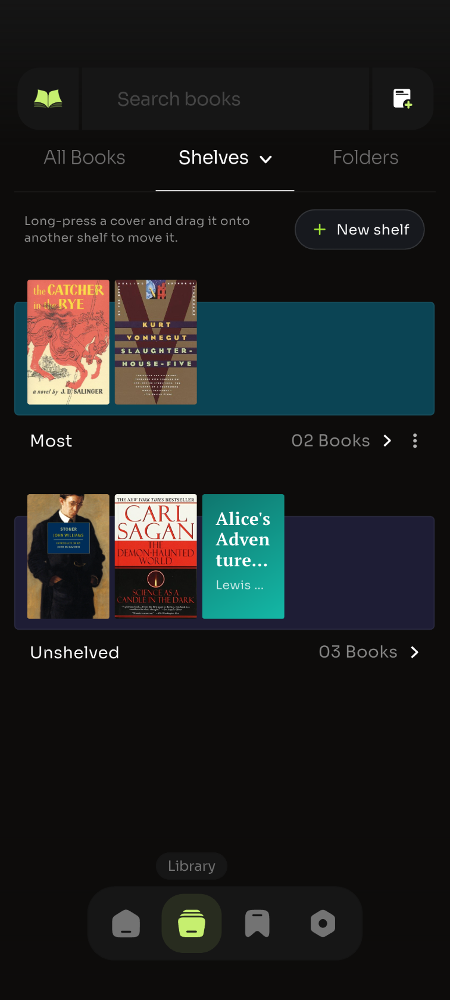
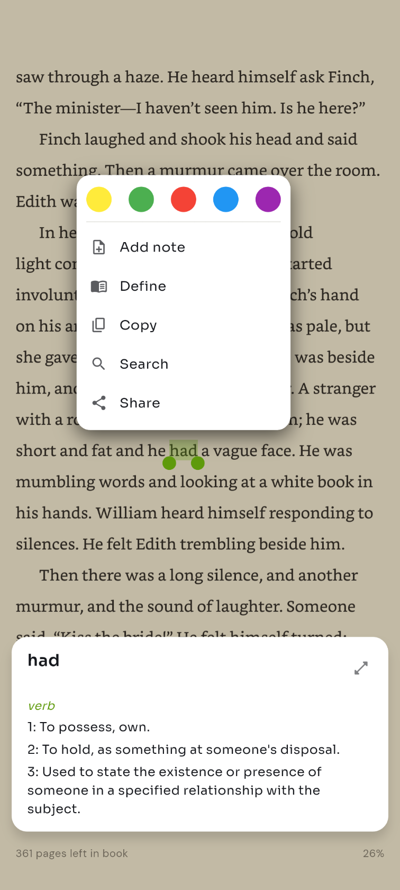
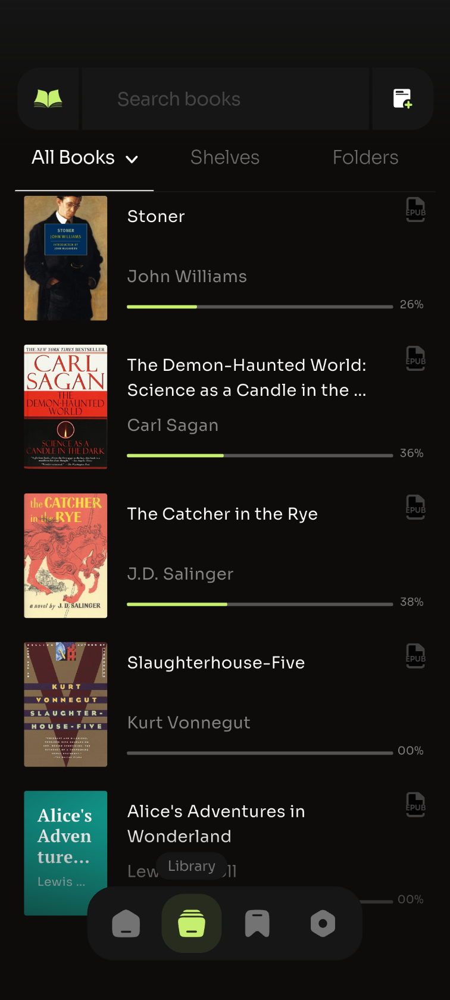
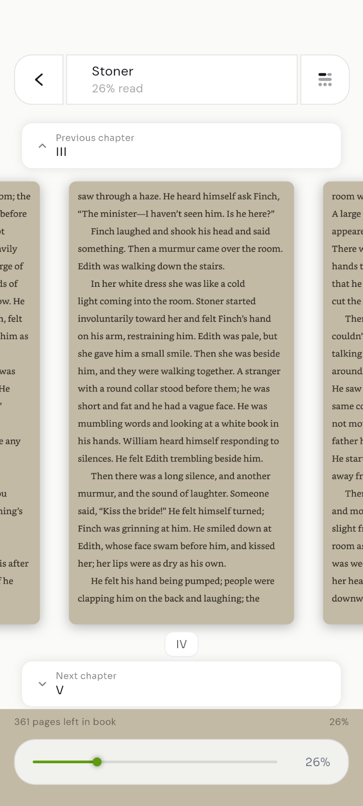
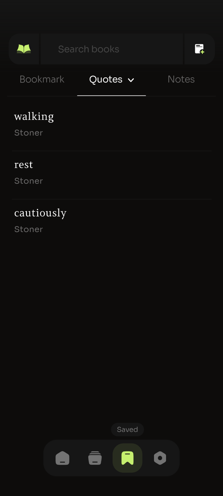
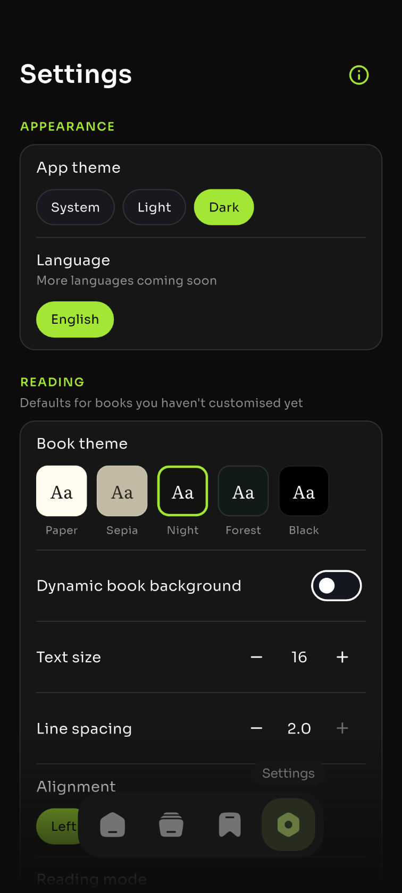

<div align="center">


# Fourpages

**A free, offline book reader for Android. No ads, no account, no tracking.**

[](https://github.com/sthrnilshaaa/fourpages/actions/workflows/ci.yml)
[](https://github.com/sthrnilshaaa/fourpages/releases/latest)
[](LICENSE)
[](https://github.com/sthrnilshaaa/fourpages)
[](https://ko-fi.com/L2L124TL7L)

[**Download**](#download) · [Features](#features) · [Build](#build-from-source) · [Translate](#translations) · [Contribute](CONTRIBUTING.md) · [Support](#support)

</div>

---

## Screenshots

<table>
  <tr>
    <td align="center"><br><sub>Home</sub></td>
    <td align="center"><br><sub>Shelves</sub></td>
    <td align="center"><br><sub>Reader</sub></td>
    <td align="center"><br><sub>Highlights & notes</sub></td>
  </tr>
  <tr>
    <td align="center"><br><sub>Library</sub></td>
    <td align="center"><br><sub>Reader controls</sub></td>
    <td align="center"><br><sub>Saved</sub></td>
    <td align="center"><br><sub>Settings</sub></td>
  </tr>
</table>

## Features

**Library**
- Import **EPUB** and **PDF**; **TXT, Markdown, HTML and DOCX** are turned into books.
- Import single files or **scan whole folders**.
- **Shelves**: make your own, long-press a book and **drag it between shelves**.
- Sort by recently added, title, author or progress; Recent Reading on Home.

**Reading**
- Fast native Android reader: **paged** (with page-curl turns) or **scrolled**.
- Themes (paper, sepia, night, forest, black), fonts, text size, line spacing,
  alignment and margins, per book or as defaults for all books.
- Chapters, in-book search, bookmarks, a progress scrubber and "pages left".
- **Highlights in colours, notes, Copy / Share / Search, and Define** (dictionary).
- PDF with pinch zoom, pan and go-to-page.

**Everything else**
- Saved tab with all your bookmarks, quotes and notes across books.
- Reading stats, break reminders and a daily reading reminder.
- Home-screen widget to continue reading.
- Built-in **guide** to every feature (Settings › i).
- **Private by design**: books, notes and progress never leave your phone.

## Download

| | |
|---|---|
| **GitHub Releases** | [Latest APK](https://github.com/sthrnilshaaa/fourpages/releases/latest): pick the file for your phone (most phones: `arm64-v8a`). Updates itself from GitHub. |
| **Google Play** | Coming soon. Updates through Google Play. |

The two builds are the same app; they only differ in how they update.

## Build from source

Requirements: [Flutter](https://docs.flutter.dev/get-started/install) (stable, see
`FLUTTER_VERSION` in [`.github/workflows/ci.yml`](.github/workflows/ci.yml)), Java 17, Android SDK.

```sh
git clone https://github.com/sthrnilshaaa/fourpages.git
cd fourpages
flutter pub get
flutter run                     # Android, github flavor
flutter test                    # unit & widget tests
```

### Android flavors

| Flavor      | Published on    | Updates |
|-------------|-----------------|---------|
| `github`    | GitHub Releases | Checks the latest GitHub release once a day (and from Settings › About › Check for updates), downloads the APK for the phone's CPU and opens the system installer. |
| `playstore` | Google Play     | Google Play in-app update. Has no install-apps permission. |

```sh
flutter build apk --release --flavor github --split-per-abi
```

Release builds are signed with the key in `android/key.properties` (git-ignored)
when present, otherwise with the debug key.

## Project structure

```
lib/                 Flutter app (core / domain / data / application / presentation)
android/app/         Android app; src/github and src/playstore hold the updater per flavor
android/reader/      Native Kotlin reader engine (Readium parsing + own page engine)
shaders/             Page-curl shader
test/                Unit & widget tests
third_party/         Vendored, patched packages (see third_party/README.md)
media/               README / store images
.github/             CI, release workflow, issue & PR templates
```

## Translations

All UI text lives in [`lib/l10n/app_en.arb`](lib/l10n/app_en.arb). To add or improve a language:

1. Fork the repo.
2. Copy `lib/l10n/app_en.arb` to `lib/l10n/app_<code>.arb` (for example `app_hi.arb`
   for Hindi, `app_es.arb` for Spanish) and translate the values. Keep the keys,
   the `{placeholders}` and the `@key` blocks as they are.
3. Run `flutter gen-l10n` and check it in the app (Settings › Appearance › Language).
4. Open a pull request. Partial translations are fine; missing strings fall back to English.

Not a coder? Open a [translation issue](https://github.com/sthrnilshaaa/fourpages/issues/new?template=translation.yml).
The Play Store listing is translated separately in the Play Console.

## Contributing

Bug reports, ideas and pull requests are welcome. Start with [CONTRIBUTING.md](CONTRIBUTING.md),
and please follow the [Code of Conduct](CODE_OF_CONDUCT.md). Security issues:
see [SECURITY.md](SECURITY.md).

## Support

Fourpages is free and has no ads. If it's useful to you:

- ☕ [Buy a coffee on Ko-fi](https://ko-fi.com/L2L124TL7L)
- ⭐ [Star the repo](https://github.com/sthrnilshaaa/fourpages)
- Rate it on Google Play or share it with a friend

## Acknowledgements

[Flutter](https://flutter.dev) ·
[Readium Kotlin Toolkit](https://github.com/readium/kotlin-toolkit) (BSD-3) ·
[sakura_epub](https://pub.dev/packages/sakura_epub) (BSD-3) ·
[flutter_inappwebview](https://github.com/pichillilorenzo/flutter_inappwebview) (Apache-2.0) ·
[epub.js](https://github.com/futurepress/epub.js) (BSD-2) ·
[Free Dictionary API](https://dictionaryapi.dev)

## License

Fourpages is free software under the [GNU General Public License v3.0](LICENSE).
You may use, study, share and change it; if you distribute a modified version,
it must also be GPL-3.0 with its source available.
